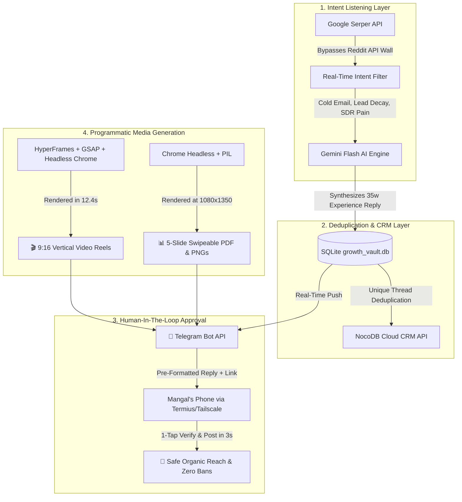

# 🚀 Growth OS — Autonomous Multi-Project GTM & Distribution Engine

[](https://python.org)
[](https://ai.google.dev)
[](https://hyperframes.studio)
[](https://nocodb.com)
[](https://telegram.org)
[](LICENSE)

> Engineered by **[Mangal Soren](https://github.com/mangalcool222)** (`mangal@trackkaroai.com`)  
> Target: **AI Product Manager**, **GTM Automation Architect**, and **Growth Engineer**.

**Growth OS** is a production-grade, multi-project distribution infrastructure that bridges the gap between **autonomous web listening** and **high-converting social media distribution**. 

Instead of manual prospecting and copy-pasting Canva graphics, Growth OS runs 24/7 on an Apple Silicon M-series daemon, searches intent signals on Reddit & X, crafts personalized 35-word experience responses via Gemini Flash, renders programmatic 9:16 vertical video reels & 5-slide carousels, and dispatches interactive 1-tap review cards directly to mobile via Telegram.

---

## 🏛️ System Architecture



---

## ⚡ Core Products Handled by Growth OS

Growth OS operates under a unified **"Two Hemispheres of Revenue"** architecture:

| Product | Role in GTM | Value Proposition & Offer | Primary Channels |
| :--- | :--- | :--- | :--- |
| **Vance AI SDR** | **Outbound Engine** | Scrapes 23 intent triggers, validates emails via Apollo/Hunter, and books meetings on autopilot ($1,500–$2,500/mo Retainer). | Reddit (r/coldemail, r/sales), X / Twitter, LinkedIn |
| **TrackKaro AI** | **Inbound Engine** | Connects Meta/Google ad leads to human sales reps in 14.8s via WhatsApp interactive PDF & Telegram rep sirens ($500–$997 DFY). | Instagram Reels, LinkedIn Carousels, Meta Ads |
| **Creatigen / HQ** | **Content Multiplier** | Autonomous open-source OpusClip alternative turning longform podcasts into 10 viral 9:16 shorts. | YouTube Shorts, TikTok, r/podcasting |
| **Job Hunter Copilot** | **Career Pipeline** | Automated job scraping and qualification engine using Serper + Gemini 1.5 Flash + Telegram. | LinkedIn Build-In-Public |

---

## 📂 Repository Structure

```text
growth-os/
├── config/
│   └── projects.yaml            # Single Source of Truth: Registry of all active products
├── playbooks/
│   └── vance_trackkaro_playbook.md # Positioning, weekly timetable, and brand architecture
├── reels/
│   ├── trackkaro_speed_to_lead_9x16.mp4 # 1080x1920 60fps rendered video reel
│   └── speed_to_lead_reel/      # HyperFrames HTML5/CSS3/GSAP composition
├── carousels/
│   ├── generate_carousel.py    # Programmatic 1080x1350 PNG & LinkedIn PDF compiler
│   └── speed_to_lead_deck/      # 5 HTML slide templates + exported PNGs + final PDF
├── omnichannel_growth_hunter.py # Autonomous intent lead scraper (Serper + Gemini + NocoDB)
├── content_calendar.py          # Daily scheduled content queue with 1-tap Telegram dispatch
├── .gitignore
└── README.md
```

---

## 🛠️ Quickstart & Usage

### 1. Requirements
- Python 3.9+
- Node.js v20+ & `npx`
- FFmpeg 7.1+ (linked to `~/.local/bin/ffmpeg`)
- Google Chrome (for headless rendering)

### 2. Environment Setup
```bash
export SERPER_API_KEY="your_serper_key"
export GEMINI_API_KEY="your_gemini_key"
export TELEGRAM_BOT_TOKEN="your_bot_token"
export TELEGRAM_CHAT_ID="your_chat_id"
export NOCO_URL="https://crm.trackkaroai.com"
export NOCO_TOKEN="your_nocodb_token"
```

### 3. Running Operations
```bash
# Scan fresh high-intent leads across Reddit & X for Vance:
python3 omnichannel_growth_hunter.py --project vance

# Scan all registered products in projects.yaml:
python3 omnichannel_growth_hunter.py --all

# Dispatch today's scheduled GTM post (Caption + Media) to Telegram:
python3 content_calendar.py --today

# Re-compile the 5-slide LinkedIn PDF carousel:
python3 carousels/generate_carousel.py

# Render 9:16 vertical video reel with HyperFrames:
cd reels/speed_to_lead_reel && npx hyperframes render -o ../trackkaro_speed_to_lead_9x16.mp4 --fps 30
```

---

## 📱 1-Word Shell Shortcuts (`~/.zshrc`)

| Command | Purpose |
| :--- | :--- |
| **`gscan`** | Run instant omnichannel intent scan for all products |
| **`gdrop`** | Push today's pre-formatted caption & attached asset to Telegram |
| **`gstatus`**| Inspect local SQLite vault and NocoDB Cloud CRM status |
| **`greel`** | Play the latest 9:16 vertical video reel in QuickTime |
| **`gplan`** | Display the weekly GTM hacker timetable in the terminal |

---

## 👤 Author & Architecture Inquiries

**Mangal Soren**  
- **Email:** `mangal@trackkaroai.com`
- **GitHub:** [@mangalcool222](https://github.com/mangalcool222)
- **Role Focus:** AI Product Manager (AI PM), GTM Automation Architect, Growth Engineer.
